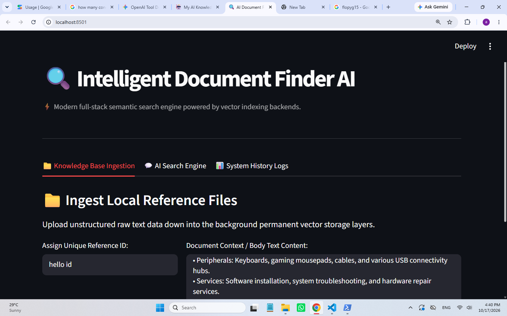
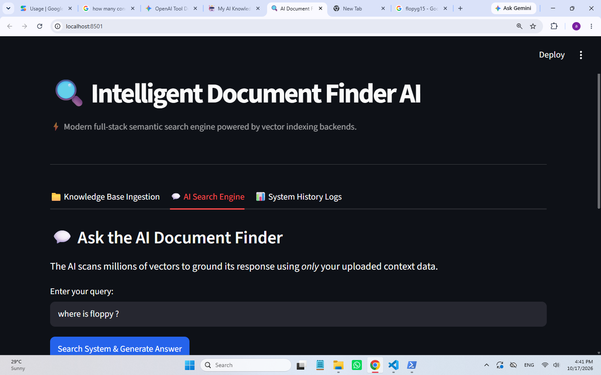
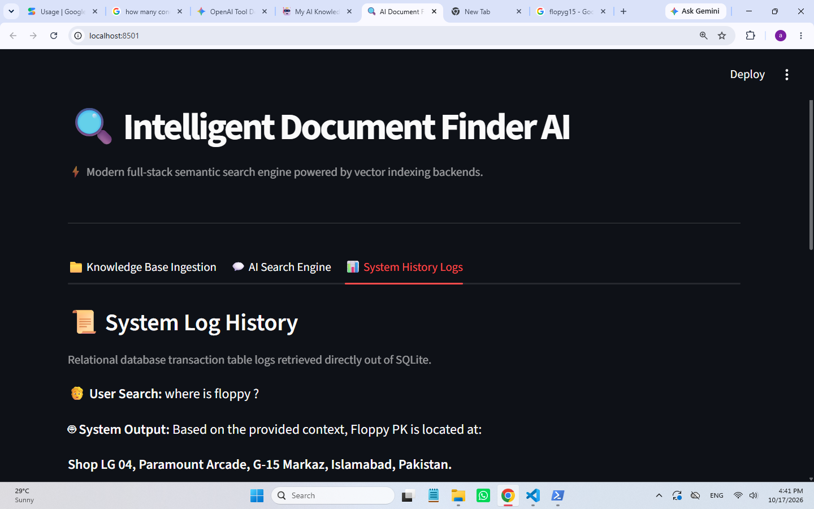

# 🔍 Intelligent Document Finder AI

> A modern, full-stack semantic search engine and RAG (Retrieval-Augmented Generation) system built with **FastAPI**, **Streamlit**, **ChromaDB**, **SQLite**, and **Google Gemini API**.

---

## 🚀 Tech Stack & Architecture

* **Frontend:** Streamlit (Interactive multi-tab dashboard with responsive session state management)
* **Backend API:** FastAPI (Async endpoints, Pydantic data validation, and custom error handling)
* **Vector Database:** ChromaDB (Persistent local vector storage for semantic embeddings)
* **Relational Logging:** SQLite (Tracks user search transactions and system responses)
* **LLM Engine:** Google GenAI SDK (`gemini-3.8-flash`)

---

## 📸 Application Workflow & UI Walkthrough

### 1. Knowledge Base Ingestion
Upload unstructured text data and bind it to a unique reference ID. The system embeds and indexes the text directly into the local permanent vector store.


### 2. AI Search Engine (Semantic Retrieval)
Ask natural language questions. The system scans vector weights to extract matching context and grounds Gemini’s response *exclusively* using your ingested documents.


### 3. System History Logs
Every interaction is transparently recorded and retrieved from a relational SQLite database transaction table for auditing.


---

## ⚙️ Local Installation & Setup

1. **Clone the repository:**
   ```bash
   git clone [https://github.com/AfnanKhan55/intelligent-document-finder-ai.git](https://github.com/AfnanKhan55/intelligent-document-finder-ai.git)
   cd intelligent-document-finder-ai
